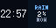
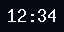

# Dynamic Dashboard

Dynamic Dashboard is a standalone Tidbyt app intended to run as the only app
on a device. The clock is always present. Optional tiles appear when their
signal is active:

| Active items | Layout |
| --- | --- |
| 1 | One full-screen tile |
| 2 | Two 32x32 half-screen tiles |
| 3 | Two 32x16 quarter tiles and one 64x16 half tile |
| 4 | Four 32x16 quarter tiles |

The current item order is clock, Spotify, weather, then sports. The maximum is
four tiles.



Layout animation:



The animation cycles through Custom Clock, Hex Color Clock, and Binary Clock
styles, showing each style across the supported layouts. Choose the clock
style in the app settings; the default Custom Clock renderer uses a compact
5x8 `HH:MM` face in quarter tiles and scales up when more room is available.

## Current implementation

- Clock: implemented; uses the Tidbyt timezone (`$tz`) and offers three
  selectable compact renderers: Custom Clock (clean digital), Hex Color Clock
  (time-derived color), and Binary Clock (binary digits). The tile renderer
  adapts font and layout to the allocated tile size.
- Tiling: implemented in `dynamic_dashboard.star`; deterministic for one
  through four active items, with geometry tests in `tests/test_layout.py`.
- Layout preview: implemented as `demo_mode=true`, which cycles through all
  four supported layouts without making provider requests.
- Weather: implemented for US National Weather Service locations. It adds a
  tile when one of the next six hourly periods has precipitation probability
  or a precipitation forecast.
- Sports: implemented with ESPN's public scoreboard endpoints for NFL, NBA,
  MLB, NHL, and MLS. It adds the first live game matching a configured team.
- Spotify playback: implemented against `/v1/me/player` when a valid bearer
  token is supplied. The tile includes a compact playback progress bar when
  Spotify reports track duration and progress.

All non-successful provider responses are intentionally fail-soft: the clock
remains visible. Provider results are cached with short TTLs so the app does
not fetch on every render.

## Community app adaptations

Community Tidbyt applets are standalone Pixlet entrypoints, not widgets that
can be loaded directly into another app. The three clock choices above adapt
the render styles from [Custom Clock](../community/apps/customclock/custom_clock.star),
[Hex Color Clock](../community/apps/hexcolorclock/hex_color_clock.star), and
[Binary Clock](../community/apps/binaryclock/binary_clock.star) into
dimension-aware dashboard renderers. Spotify's progress bar is a compact
single-item adaptation of [Any Progressbar](../community/apps/anyprogressbar/any_progressbar.star).
This keeps the dashboard self-contained while retaining recognizable designs.

## Explicit stubs and limitations

- Spotify OAuth, refresh-token storage, and automatic account/integration
  discovery are not implemented. For now, `spotify_access_token` is a
  temporary developer input and should not be treated as secure secret
  storage. The OAuth follow-up is marked `TODO(spotify-oauth)` in the app.
- Weather currently uses the US NWS API only and checks six hours. There is no
  international provider fallback, radar imagery, or multi-location support.
- Sports matching is simple abbreviation/name matching and shows only the
  first matching live event. There is no team picker, logos, game paging, or
  finished/upcoming game tile.
- There is no persisted stale-data store beyond Pixlet's HTTP cache. A
  provider outage therefore removes that provider's tile until a later
  successful fetch.

## Local verification

With Pixlet `v0.34.0` or newer installed:

```sh
pixlet render dynamic_dashboard.star
pixlet serve dynamic_dashboard.star

# Preview all three community-inspired clock styles across all layouts
pixlet render --gif --max_duration 15000 --output dynamic_dashboard_layouts.gif dynamic_dashboard.star demo_mode=true clock_style=all
```

The repository also contains a small geometry test that does not require
Pixlet:

```sh
python3 tests/test_layout.py
```
